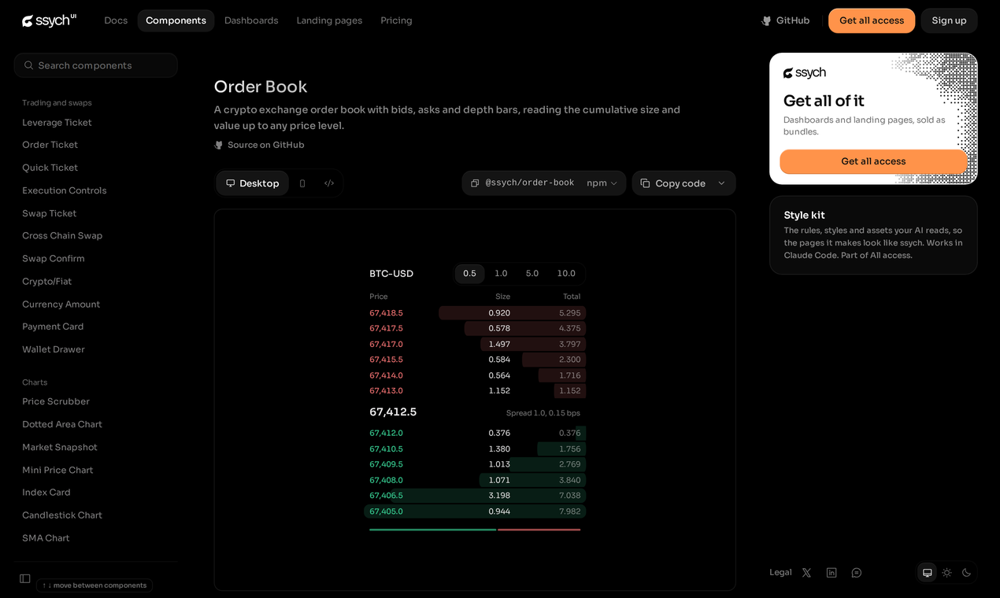

# React order book component

A crypto exchange order book for React and Tailwind: bids and asks with depth bars, price grouping, and the cumulative size and value up to any level you point at. MIT, TypeScript, no chart library.



**Live demo:** https://ssych.com/library/order-book

## Install

With the shadcn CLI, into any React project that uses Tailwind:

```bash
npx shadcn@latest add @ssych/order-book
```

The source lands in your project and is yours to change. Or copy the files by hand:

- `components/ui/order-book.tsx`
- `components/ui/live-figure.tsx`
- `components/ui/use-pointed.ts`
- `components/ui/segmented-control.tsx`
- `components/ui/control-classes.ts`
- `lib/utils.ts`

and install `clsx`, `motion`, `tailwind-merge`.

## Use

```tsx
import { OrderBook } from "@/components/ui/order-book"

export default function Market() {
  return (
    <OrderBook
      symbol="BTC-USD"
      unit="BTC"
      bids={[{ price: 67412.5, size: 0.84 }, { price: 67412, size: 1.2 }]}
      asks={[{ price: 67413, size: 0.5 }, { price: 67413.5, size: 2.1 }]}
      tick={0.5}
      feed={false}
    />
  )
}
```

Props: symbol, unit, bids, asks (arrays of { price, size }), tick, groupings, rows, priceDp, sizeDp, feed (a demo feed, on by default: turn it off when you pass live levels), className.

## Related components

It is part of [ssych ui](https://ssych.com/library), free MIT components for trading, crypto and finance screens: depth-chart, trade-tape, order-ticket, leverage-ticket, positions-table. See them together at https://ssych.com/library/s/perps-dex.

## License

MIT
